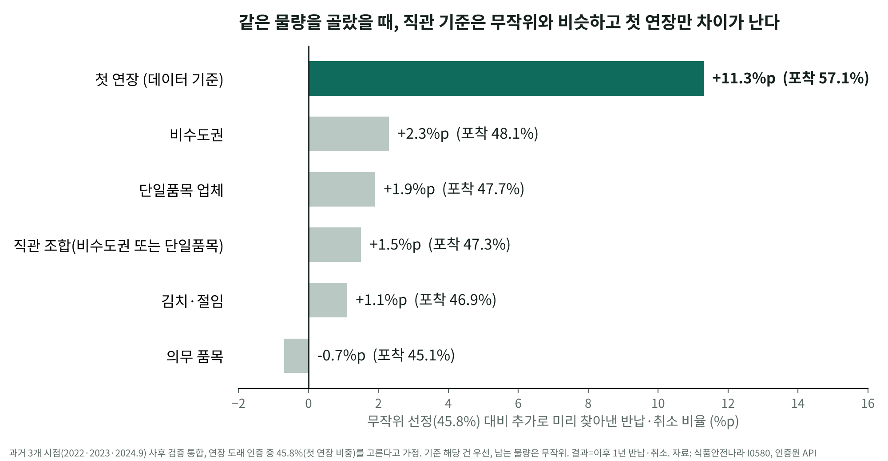

# HACCP 첫 연장 우선관리 분석

> 2026 한국식품안전관리인증원 공공데이터 분석·활용 경진대회 (데이터 분석 부문) · **1차 합격, 2차 발표 심사(2026.10.30)**
> 담당: 양다현([@ekgus040](https://github.com/ekgus040)) — 데이터 수집·결합, 분석, 기획서·발표

HACCP 인증을 처음 받은 업체가 **첫 인증주기(첫 연장)에서 가장 많이 빠져나간다**는 것을 공공데이터로 확인하고, 이들을 연장 전에 먼저 관리하는 우선관리 명단과 운영 방안을 제안한 분석입니다.

## 핵심 결과

- **사후 검증**: 과거 3시점(2022·2023·2024.9)으로 돌아가 보면, 첫 연장을 앞둔 인증은 이후 1년 안에 반납·취소될 오즈비 **1.53**
- **기준 비교**: 같은 물량(연장 도래 인증의 45.8%)을 고를 때 첫 연장 기준 포착률 **57.1%** [95% CI 51.0~63.6], 무작위 대비 **+11.3%p**
  - 비수도권·단일품목·의무품목 등 직관적 기준 5개는 모두 무작위와 2%p 안쪽
- **물량 산정**: 향후 연장심사 도래 8,515건 중 첫 연장 3,195건(37.5%), 월별·지역지원별 물량 달력 산출
- **우선관리 명단**: 2027~2028년 첫 연장 대상 **3,171건(2,734개 업체)** — 지역지원 한 곳당 월 22건 수준이라 추가 인력 없이 순서만 조정
- **해석의 한계를 함께 제시**: 시점 외 검증 AUC 0.55~0.63으로 낮아 '위험 점수'가 아니라 '물량 배분 기준'으로 제안, 기술지원 효과(OR 0.47)는 E-value 3.68·음성 대조로 민감도만 보고하고 인과 확인은 무작위 시범으로 설계



## 데이터

| 출처 | 데이터 |
| --- | --- |
| 공공데이터포털 (한국식품안전관리인증원) | 식품 제조가공 HACCP업체 정보, 인증업체·제품별 인증, 스마트HACCP 인증·기술지원 업체, 심사수수료 |
| 식품안전나라 OpenAPI | I0580 HACCP 지정현황, I1220 식품제조가공업, I0470 행정처분결과 |
| 인증원 연차보고서 2025 | 지역지원 관할 구분 |

OpenAPI로 직접 수집했고(2026.9, 2026.10.21 재수집), 원천 데이터와 API 키가 들어간 수집 스크립트는 저장소에 포함하지 않았습니다.

## 분석 흐름

| 단계 | 코드 | 내용 |
| --- | --- | --- |
| 상태 분류 | `eda_01`, `eda_02` | 인증 상태(유지·반납·취소) 분류, 시도별 적용률 |
| 이탈 생존분석 | `eda_03`, `eda_04` | Kaplan-Meier, Cox PH로 반납·취소 위험 요인 |
| 강건성·사후 검증 | `eda_05`~`eda_07` | 과거 시점 기준 첫 연장 효과 재검증 |
| 물량 산정 | `eda_09`~`eda_16` | 연장심사 도래 규모·월별·지원별 물량, 기획서 수치 23개 assert 검증 |
| 우선관리 명단 | `eda_17` | 2027~2028 첫 연장 명단 (공개본은 업체명 마스킹 예시만) |
| 2차 발표 보강 | `eda_18`~`eda_19` | 같은 물량 포착률 비교, 업체 단위 부트스트랩 1,000회, 동일 관측창 비교, E-value |

## 실행

```bash
pip install pandas numpy lifelines
# 원천 데이터를 1_원천데이터/ 에 둔 뒤
python 4_분석/코드/eda_16_v9_final_export.py   # 기획서 본문 수치 재생성 + assert 검증
```

결과 파일은 `4_분석/결과/`에 있습니다 (`v9_최종/`: 기획서 수치 대응표, `발표보강_1021/`: 2차 발표 보강 분석).
